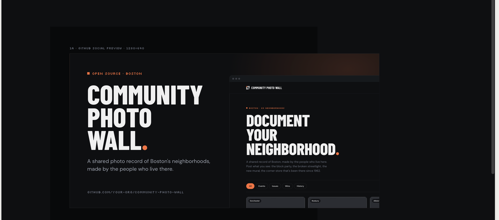

# Community Flyer Directory

**Snap a flyer, and it becomes a listing anyone in the community can find.**

Paper flyers for clinics, food drives, ESL classes, and community events are easy to miss and impossible to search. This app turns a photo of one into a clean, accessible, searchable listing. Cloudinary reads the flyer, writes the alt text, delivers every image, and builds a shareable social card.

## Demo



## Contents

- [How it works](#how-it-works)
- [Tech stack](#tech-stack)
- [Setup](#setup)
- [Environment variables](#environment-variables)
- [Scripts](#scripts)
- [Project layout](#project-layout)
- [How we use Cloudinary](#how-we-use-cloudinary)
- [Security](#security)
- [Accessibility](#accessibility)
- [Deploy checklist](#deploy-checklist-vercel)
- [Known limits and ideas](#known-limits-and-ideas)

## How it works

1. **A contributor uploads a flyer photo** (no login) with the Cloudinary Upload Widget.
2. **`/api/analyze` reads it** with Cloudinary's OCR and AI captioning add-ons and suggests a title, date, place, contact, and image description.
3. **The contributor checks and edits the pre-filled form**, then submits. The listing is saved as `pending`.
4. **A moderator approves it** and it appears publicly.
5. **Visitors browse, search, and filter** approved listings (no login), open one, and **share or download its social card**.

AI is a convenience, never a gate: if OCR or captioning fails or isn't enabled, the form still works by hand.

## Tech stack

React 19 + Vite + TypeScript (strict) · Tailwind CSS v4 · React Router · `@cloudinary/react` + `@cloudinary/url-gen` · Supabase (Postgres, Auth, Row Level Security) · Vercel (hosting and the `/api` function) · Vitest + Testing Library + axe-core

## Setup

You need Node 20.19+ (or 22.12+), a Cloudinary account, a Supabase project, and the Vercel CLI (`npx vercel`).

### 1. Install

```bash
npm install
cp .env.example .env     # then fill in the values (see the table below)
```

### 2. Cloudinary

1. **Upload preset:** _Settings → Upload → Upload presets → Add upload preset_.
   - Signing mode **Unsigned**.
   - **Public ID prefix: `flyers`** (and an asset folder if you like). The app and the database only accept ids that start with `flyers/`. This is the preset's *prefix* setting, not the preset's name.
   - Allowed formats: `jpg, jpeg, png, webp, heic`. Optional incoming transformation `c_limit,w_2500,h_2500`.
   - Put the preset's name in `VITE_CLOUDINARY_UPLOAD_PRESET`.
2. **Add-ons:** subscribe to **OCR Text Detection and Extraction** and **Cloudinary AI Content Analysis** (each has a free tier). Either one works alone.
3. **Keys:** copy the API key and secret from _Settings → API Keys_ into `.env` (never prefix them with `VITE_`).
4. Generative fill (`b_gen_fill`, used for odd-shaped flyers on cards) is a paid transformation. Set `USE_GENERATIVE_FILL = false` in `src/lib/cloudinary.ts` to use a plain crop instead.

### 3. Supabase

1. In the SQL editor run **`supabase/migrations/0001_listings.sql`**. _(If you created the database from an older version that required a different image prefix, run `0002_flyers_prefix.sql` instead. Never both.)_
2. **Create a moderator:** _Authentication → Users → Add user_ (tick **Auto Confirm User**), then:
   ```sql
   insert into public.moderators (user_id)
   select id from auth.users where email = 'moderator@example.com';
   ```
3. **Turn off public sign-ups:** _Authentication → Sign In / Providers → Email → Allow new users to sign up: off_. Being signed in is not enough to moderate; only users in `public.moderators` can.

### 4. Run it

```bash
npx vercel dev     # frontend + /api functions together (first run links a Vercel project)
```

`npm run dev` starts only the frontend. Everything works except analysis, which then reports "couldn't read the flyer" and the form falls back to manual entry.

## Environment variables

| Variable | Where | Purpose |
|---|---|---|
| `VITE_CLOUDINARY_CLOUD_NAME` | client | Cloud name for delivery URLs and the widget |
| `VITE_CLOUDINARY_UPLOAD_PRESET` | client | The unsigned preset's name |
| `VITE_SUPABASE_URL` | client | Project URL: `https://<ref>.supabase.co` (no `/rest/v1`) |
| `VITE_SUPABASE_ANON_KEY` | client | Public `anon` key (safe in the browser; RLS protects the data) |
| `CLOUDINARY_API_KEY` | **server only** | Used by `/api/analyze` |
| `CLOUDINARY_API_SECRET` | **server only** | Used by `/api/analyze`. Never ship to the browser |
| `SUPABASE_SERVICE_ROLE_KEY` | **server only** | Not used by any current function. Leave unset unless you add one |

`.env` is git-ignored. Keep `.env.example` in sync when adding a variable.

## Scripts

| Command | What it does |
|---|---|
| `npm run dev` | Vite dev server (frontend only) |
| `npm run build` | Type-check and production build |
| `npm run lint` | ESLint |
| `npm test` | Unit, component, and accessibility tests (Vitest) |
| `npm run check:secrets` | Scans `dist/` for secret values, server variable names, and non-`anon` keys. Run after `build` |
| `node scripts/verify-rls.mjs` | Checks Row Level Security against your live Supabase project (read-only, can't change data). See the file header for optional signed-in checks |

## Project layout

```
api/                 Vercel function: analyze.ts (OCR + caption), _lib/ (Admin API client, flyer text parser)
shared/              Types and the public_id rule shared by client and function
supabase/migrations/ Schema, indexes, and RLS policies
scripts/             verify-rls.mjs, check-dist-secrets.mjs
src/lib/             cloudinary.ts (all transformations), shareCardLayers.ts, listings.ts, validation
src/components/      Layout, cards, filters, forms, share card, state components
src/pages/           Browse, Add a flyer, Listing, Moderator login, Review queue
DESIGN.md            Visual design system (tokens, fonts, components)
PLAN.md              Original build plan and risk notes
```

## How we use Cloudinary

| Feature | Cloudinary capability | File |
|---|---|---|
| Flyer photo upload | Upload Widget with an unsigned preset (image formats, 10 MB client limit) | `src/cloudinary/UploadWidget.tsx` |
| Pre-fill title, date, location, contact | OCR Text Detection add-on (`ocr=adv_ocr`) via the Admin API update method | `api/analyze.ts`, `api/_lib/parseFlyer.ts` |
| Suggested alt text | AI Content Analysis add-on, captioning (`detection=captioning`) | `api/analyze.ts` |
| Upload preview | `c_limit` + `f_auto` + `q_auto` delivery | `src/lib/cloudinary.ts` (`previewImage`) |
| Listing card | `c_fill,g_auto` to a 3:4 box, or `c_pad,b_gen_fill` (generative fill) for odd-shaped flyers; `f_auto,q_auto`; `srcset` at 320/480/768 w, lazy-loaded (named transformation candidate: `card`) | `src/lib/cloudinary.ts` (`cardImage`, `cardImageSet`), `src/components/ListingCard.tsx` |
| Listing detail hero | `c_limit` (whole flyer, never cropped) + `f_auto,q_auto`; `srcset` at 600/900/1200 w (named transformation candidate: `hero`) | `src/lib/cloudinary.ts` (`heroImage`, `heroImageSet`), `src/pages/ListingPage.tsx` |
| Moderator review thumbnails | The `card` look at 320 w and a 1600 w `c_limit` full-size link | `src/pages/ModQueuePage.tsx` |
| Social share card | Text overlays (`l_text`, Google Fonts `Bebas Neue` and `Inter`) for title, date and place, with `c_fit` auto-wrapping, over the whole flyer padded onto a 1200x630 canvas (`c_pad`); `f_auto,q_auto` for preview, `f_jpg` for the downloaded/attached file (named transformation candidate: `share_card`) | `src/lib/shareCardLayers.ts`, `src/lib/cloudinary.ts` (`shareCardUrl`), `src/components/ShareCard.tsx` |

Only the `public_id` is stored in the database, never a URL. The API secret is used only inside `/api`.

## Security

- **Row Level Security** is on for every table. Visitors can insert only `pending` rows (and only the user-supplied columns) and read only `approved` rows. Moderators are an allow-list table, checked by a database function. `node scripts/verify-rls.mjs` proves it.
- **Secrets:** server keys never reach the browser. `npm run check:secrets` verifies this on every build output.
- **`/api/analyze`** accepts only `flyers/…` public ids and always degrades gracefully.
- **Headers:** `nosniff`, `X-Frame-Options: DENY`, and a strict referrer policy (see `vercel.json`).

## Accessibility

Keyboard-operable everywhere with one visible focus ring, skip link, labelled form fields with errors tied to their inputs, focus moved to the page on navigation, a title per page, polite status messages (not whole-page live regions), reduced-motion support, and image descriptions for every flyer. Automated axe checks run in `npm test`.

Two deliberate deviations from `DESIGN.md`, both to meet WCAG AA: the muted text color is `#7c8494` (the spec's `#6b7280` is only 3.5:1 on cards), and inputs and secondary buttons use a stronger `border-strong` token (the 8% border is 1.25:1, below the 3:1 needed to see a field's edge).

## Deploy checklist (Vercel)

**Before the first deploy**
- [ ] Repo pushed to GitHub; project imported in Vercel with the **repo root** as the root directory. Framework preset **Vite**, build command `npm run build`, output `dist`.
- [ ] Environment variables set for **Production and Preview**: `VITE_CLOUDINARY_CLOUD_NAME`, `VITE_CLOUDINARY_UPLOAD_PRESET`, `VITE_SUPABASE_URL`, `VITE_SUPABASE_ANON_KEY`, `CLOUDINARY_API_KEY`, `CLOUDINARY_API_SECRET`. (`VITE_` values are baked in at build time, so redeploy after changing them.)
- [ ] Cloudinary: unsigned preset with public ID prefix `flyers`; OCR and AI Content Analysis add-ons enabled.
- [ ] Supabase: migration run; at least one moderator inserted; **public sign-ups off**; _Authentication → URL Configuration_ Site URL set to the production URL.

**After deploying, check each of these on the live URL**
- [ ] `/` loads; refresh on `/submit` and `/mod/login` still loads the app (not a 404).
- [ ] Upload a real flyer: preview appears, fields pre-fill (or the "couldn't read" note appears), submit succeeds.
- [ ] `/mod/login` → approve the listing → it appears on `/` and opens at `/listing/:id`.
- [ ] The share card builds; Share and Download work on a phone and a desktop.
- [ ] A `GET` to `/api/analyze` returns 405, and no secret appears in the page source or network tab.
- [ ] `npm run build && npm run check:secrets` passes, and `node scripts/verify-rls.mjs` passes against the production Supabase project.

**Keep an eye on**
- Cloudinary add-on quotas (OCR, AI Content Analysis) and transformation credits (generative fill is the expensive one).
- Spam uploads: the unsigned preset is public by design. Moderation keeps junk off the site, and you can enable Cloudinary moderation on the preset.

## Known limits and ideas

- Text in Chinese, Japanese, and Korean is left off the share card (it needs a custom font). Amharic and Arabic work.
- Pasting a listing link into a chat app doesn't preview the share card; that needs a small server-rendered page with Open Graph tags (stretch).
- Browse shows the 60 most relevant listings; there's no pagination yet.
- Stretch: rate-limit `/api/analyze`, use named transformations (`card`, `hero`, `share_card`) in the Cloudinary console, a Content-Security-Policy, and a moderator view of rejected listings.
